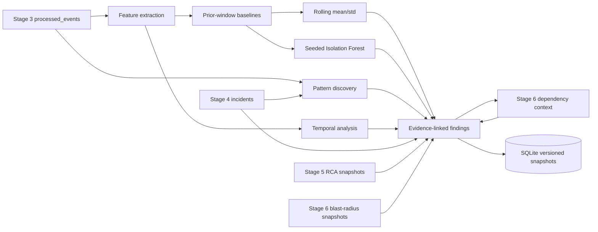
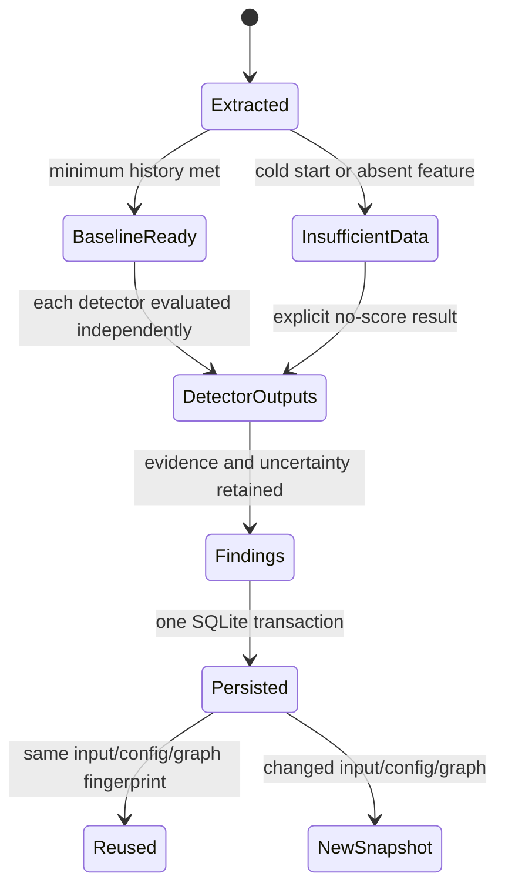

# Advanced Intelligence Architecture

Stage 7 reads Stage 3 `processed_events` as immutable source records. It computes event-time windows, builds strictly prior per-service baselines, runs separate statistical and unsupervised detectors, discovers recurring signatures, and adds Stage 6 dependency context. It writes versioned findings and model metadata to additive SQLite tables. It does not create incidents, change RCA reports, or assert causes.

The main API is `IntelligenceEngine.run()`. It fingerprints the processed-event payloads, explicit configuration, and current graph version. An unchanged input returns its stored snapshot. Configuration or graph changes produce a new run, retaining prior records. `SQLiteIntelligenceStore` reads Stage 4/5/6 tables if they exist and otherwise reports unavailable context without creating fake data.

Finding IDs are deterministic within a run fingerprint. Detector findings are kept separate: raw z-like deviations and Isolation Forest path-length scores are not normalized into one shared confidence. Pattern and cross-service findings carry their own evidence and limitations. `created_at` identifies persistence time; event-window timestamps remain separate.

The dependency-free Isolation Forest is a small standard-library implementation of random isolation trees. This choice keeps the project's Python 3.10+ install footprint empty; scikit-learn was not installed in the inspected environment. Its quality is evaluated independently and must be treated cautiously given the poor synthetic precision measured for this fixture.

## Data flow and boundaries

- Source event payloads are not updated.
- Event-time parsing rejects missing, malformed, or timezone-naive timestamps from aggregates and emits data-quality findings.
- Late events participate according to their source event time when a batch is analyzed again; the engine is batch-oriented and does not implement a persistent streaming watermark.
- Stage 4 membership, Stage 5 RCA IDs, and Stage 6 analysis IDs are attached only when supporting event references overlap stored incident membership.
- The cross-service layer uses the current stored Stage 6 graph. It reports configured paths and competing explanations but never promotes an anomaly to an incident or root cause.

## Complexity and bounds

For `N` events, feature extraction is O(N log N) due to sorting records within time buckets. Baseline and rolling statistical work is O(W·F·L), where W is service windows, F numeric features, and L is configured lookback (default 100). Isolation Forest work is O(W·T·S·log S), where T is trees (48 default) and S is sample size (at most 64); it runs only after the per-service ML minimum (12 windows). Approximate pattern comparisons are capped at 2,000 by default. Cross-service reachability is precomputed with BFS from anomalous services, then anomaly windows are joined through sorted service timelines. Candidate pairs are capped at 5,000 and emitted relationships at 500; grouped detector signals prevent duplicate same-window pairs.

## State lifecycle

