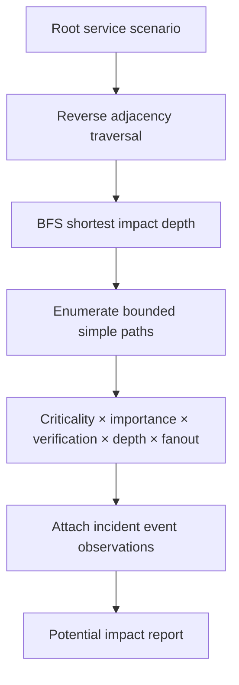

# Blast Radius Analysis architecture

Given a failed/degraded root service B, traverse reverse dependencies. For each edge A -> B, A is one level potentially affected by B. Continue through A's dependents for indirect impact. The root itself is excluded from `total_impacted_service_count`; it remains in the report as the scenario root. Each impacted service appears once, with a shortest depth and all simple explanatory paths up to `max_paths_per_service`.

The report separates structural impact from Stage 4/5 incident evidence. Events matching an impacted service are listed as observed facts; error-level records are identified as observed failure signals. `confirmed_failure` and `confirmed_root_cause` remain false because this project has no independent service health verifier. A dependency path never proves propagation.

## Configurable heuristic score

For an impacted service and its selected explanatory path:

`impact_score = criticality_factor × product(path edge importance) × product(path edge confidence) × depth_decay^(depth-1) × fanout_factor`

`fanout_factor = min(1, fanout_base + fanout_increment × number_of_direct_dependents_of_impacted_service)`.

Defaults map criticality `critical/high/medium/low/unknown` to `1.0/0.8/0.55/0.3/0.25`; verification status maps `verified/observed/configured/unverified/unknown` to `1.0/0.8/0.65/0.4/0.3`. Explicit dependency confidence takes precedence over its status factor. Default depth decay is `0.85`; fanout base/increment are `0.7`/`0.1`. The formula is intentionally simple and deterministic. Scores are heuristic structural impact rankings, not probabilities, failure risk, or calibrated business impact.

## Incident and RCA integration

`incident_context` reads Stage 4 incident membership and Stage 3 processed event payloads, then reads the latest Stage 5 report if present. A leading RCA hypothesis is analyzed as one hypothetical scenario. Competing or inconclusive reports produce a separate hypothetical analysis for each candidate event/service; the report retains the RCA assessment status and snapshot ID. No candidate is promoted to confirmed root cause. Missing RCA or missing usable service IDs return structured errors. Users can always run `blast-radius --service SERVICE_ID` explicitly.

Complexities: validation/SCC detection are O(V+E). Reverse BFS is O(V+E). Enumerating simple paths can grow exponentially in a dense graph; the per-service path cap bounds output/work, while analysis returns a warning if exceeded. Impact scoring is O(P×L) for P enumerated paths and maximum path length L, plus incident event indexing O(N). The intended graph is service-sized, local, and deterministic.
