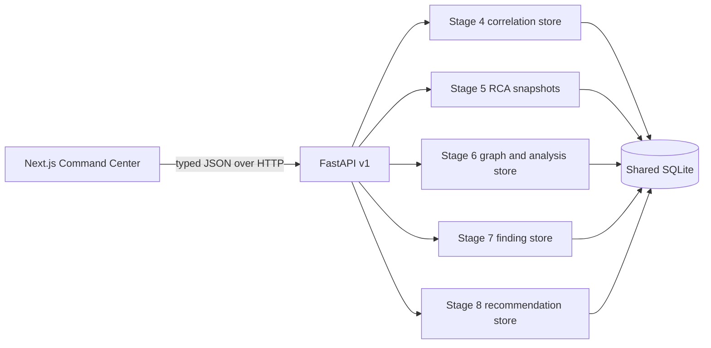

# Stage 9 — Command Center architecture

The Command Center is a Next.js/React interface backed by a small FastAPI adapter. The adapter composes the existing Stage 4–8 SQLite store APIs; it does not implement correlation, RCA, blast-radius, intelligence, or recommendation rules. Stage 1–3 events remain read-only in this layer. Recommendation status and feedback writes are delegated to Stage 8 storage validation.

The frontend requests each view from the API and renders persisted values. Service health is marked unavailable because the current stores contain configured topology and events, not a live health contract. Incident event time and processing time are shown separately when present. RCA results remain hypotheses; graph reachability is labeled potential structural impact. Detector and ranking scores are shown with their supplied interpretation, never as probabilities.

The service graph uses Stage 6 semantics: `A -> B` means A depends on B. The UI draws that configured edge. Blast radius reports supplied by Stage 6 contain potential dependents and are kept as separate scenarios.

The local API has no authentication and is intended for a local demo. CORS defaults to `http://localhost:3000`; configure allowed origins with `JARVIS_CORS_ORIGINS`. Keep the service bound to loopback unless an appropriate access-control layer is added.
