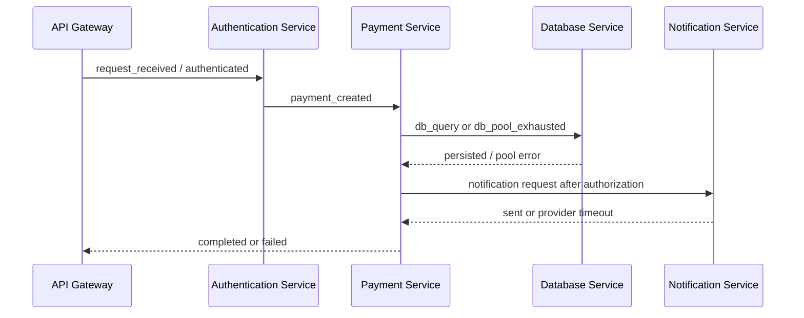

# Component interactions

Each payment trace shares a trace ID and payment ID in metadata. Events are appended causally with increasing timestamps and seeded sub-8ms jitter. These are generated records, not RPCs.

Pool exhaustion yields no query, notification, or success event. Provider timeout preserves the approved payment and queues notification; v0.1 emits no later retry attempt.
