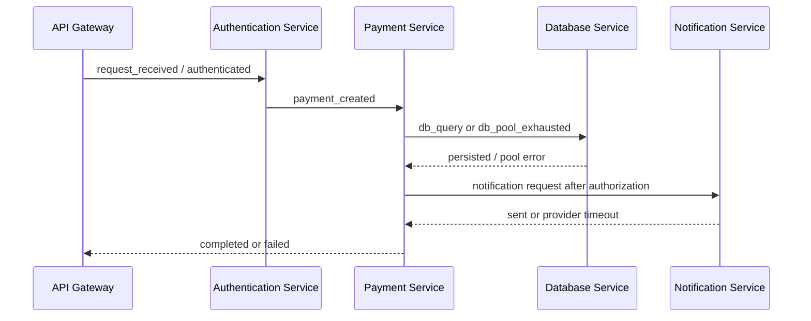
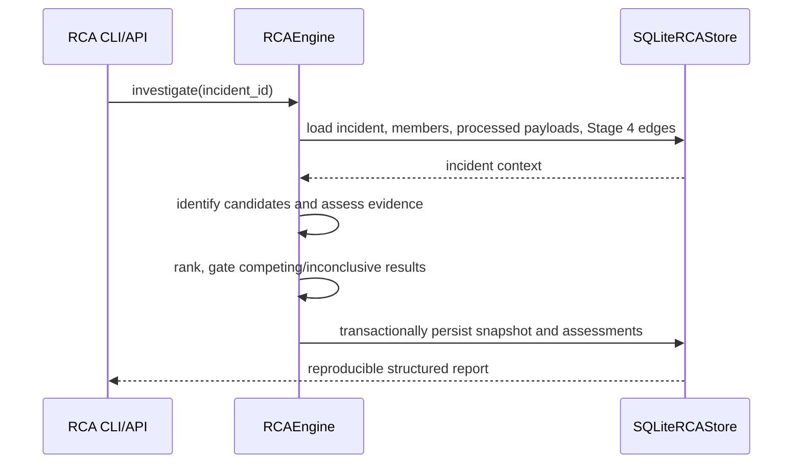

# Component interactions

Each payment trace shares a trace ID and payment ID in metadata. Events are appended causally with increasing timestamps and seeded sub-8ms jitter. These are generated records, not RPCs.

Pool exhaustion yields no query, notification, or success event. Provider timeout preserves the approved payment and queues notification; v0.1 emits no later retry attempt.

Ingestion is a separate downstream flow: adapters turn input into `SourceRecord` values, the engine validates and normalizes them, then writes accepted events to SQLite or invalid records to quarantine. It does not change event generation.

The processing engine claims ingested rows, enriches from its registry, applies matching classification rules, adds event-time/window annotations, and queries persisted window observations for repetition patterns. A final transaction writes the processed payload, evidence, watermark, processing history, and terminal state. A failure leaves the source row for a later retry.

Stage 4 reads only successful processed payloads. It creates bounded candidates from exact trace/resource indexes and event-time/service/failure indexes, scores each eligible strategy independently, then reconciles strong-evidence components as incidents. SQLite persists relationship evidence and lifecycle changes without modifying either canonical events or processed payloads.
# Stage 5 interaction

RCA does not call or modify the Stage 4 engine. It consumes its stored edge evidence and preserves the distinction between relationship and cause.
