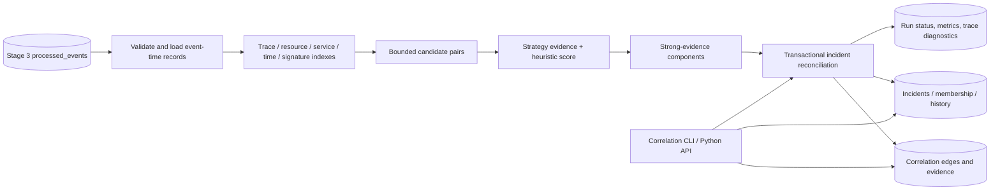

# Event correlation architecture

Stage 4 reads only successful Stage 3 `processed_events`. It never mutates ingested or processed source records. Candidate generation uses event-time and metadata indexes; evidence scoring produces pair relationships; a deterministic policy turns only sufficiently supported edges into incidents; one SQLite transaction stores edges and incident changes.

The engine distinguishes association from causation. It emits no causal direction and no root-cause claim. Every confidence value is a configured heuristic score, not a calibrated probability. Event time comes from Stage 3 temporal annotations (falling back to the original timestamp); processing time is retained separately.

`CorrelationEngine` and `CandidateGenerator` are replaceable from the persistence layer. SQLite is retained because the current system is a local, single-process prototype. Incident membership reconciliation, edge replacement, lifecycle history, and run record are committed together. Source events remain unchanged.

Candidate generation uses exact trace/resource buckets, an event-time sweep with active failure-category and dependent-service indexes, and Stage 3 pattern evidence references. The common sparse case is O(n log n + k), where `k` is the candidate output. Dense true buckets can have O(n²) output; `max_candidates` bounds memory and fails the run transactionally. The time sweep does not compare non-failure events pairwise. Approximate signature comparison is done only among time-near failure candidates. This trades global similarity recall for bounded work and reduced false positives.

Incident grouping requires a trace edge, a shared-resource edge, or both temporal and dependency evidence, plus the configurable minimum heuristic score. Two events with distinct non-empty trace IDs cannot bridge into one incident on time/dependency evidence alone; an exact shared-resource edge is required across that trace boundary. Time overlap, dependency membership, or text similarity alone cannot group incidents. A transitive graph component may connect an incident only through edges that each pass this policy; this remains association, not causal inference.

See [strategy rules](../specifications/correlation-strategies.md), [candidate algorithms](../specifications/candidate-generation.md), [evidence and scores](../specifications/correlation-evidence.md), [incident lifecycle](../specifications/incident-lifecycle.md), and [correlation API](../specifications/correlation-api.md).
