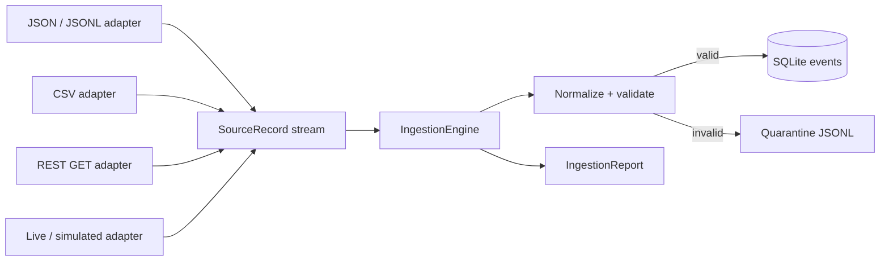

# Event ingestion architecture

Each adapter implements `records()` and yields records with raw data, adapter name, locator, and an optional parse/read error. `IngestionEngine` processes each source record independently. Valid records are normalized into the Stage 1 `Event` representation and inserted into SQLite; an existing ID increments duplicate count. Invalid records are appended to quarantine with the unmodified source data and rejection reason. The engine reports totals and elapsed throughput for the batch.

JSONL and CSV files are streamed record by record. JSON documents are parsed as an object, array, or `{ "events": [...] }` envelope. A syntax error in a JSON document quarantines that document as one record. A malformed JSONL line only rejects that line. REST ingestion performs one bounded-timeout HTTP GET and accepts a JSON/JSONL document. The live adapter adapts an iterable, including Stage 1 generated events.

There is no correlation, root cause analysis, message broker, or remote database in Stage 2.
