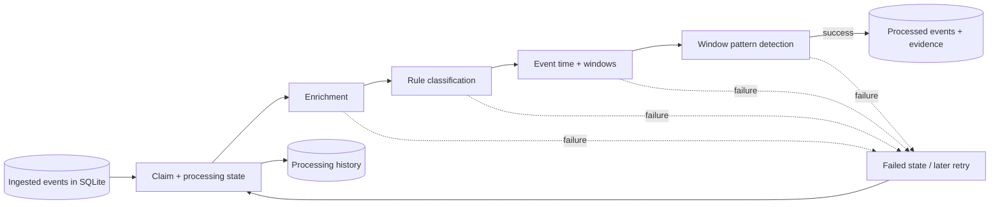

# Event processing architecture

The processing CLI reads the Stage 2 `events` table and writes to separate `processing_state`, `processed_events`, `processing_history`, `processing_watermark`, and `pattern_observations` tables in the same SQLite file. Source records are never deleted. Each claimed event passes through input validation, enrichment, classification, temporal annotation, and pattern detection in that order. The final processed payload, pattern observation, watermark, success history, and state transition commit atomically.

The stages are implemented behind small replaceable classes and a `ProcessingStore` protocol. `SQLiteProcessingStore` atomically claims rows, supports retry after a failed or stale claim, and upserts processed output on explicit replay. It is a local single-process implementation; the protocol creates an extension seam but does not claim distributed coordination.

Patterns are deterministic event-count signals scoped to fixed event-time windows. Shared text/signatures across services indicate repetition only. Stage 4 consumes these outputs as optional correlation evidence and applies separate incident grouping rules; it does not infer causality or root cause. See [event correlation architecture](event-correlation-architecture.md).
