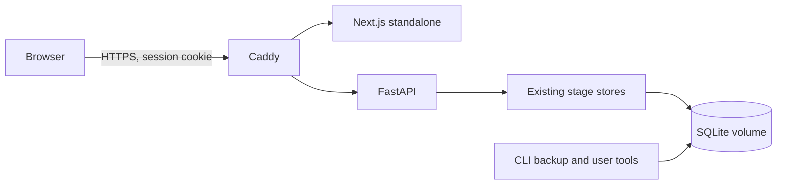

# Production Architecture and Stage 10 Scope

## Runtime shape

J.A.R.V.I.S. remains a modular Python application: the FastAPI adapter calls the existing dashboard service and Stage 3–8 stores. The Next.js Command Center remains a separate web process. SQLite is the supported persistence backend for local development, demos, and a single host. Compose uses a persistent named volume; production Compose puts Caddy in front of loopback-bound application ports for HTTPS termination.

The API is an adapter, not a second implementation of incident intelligence. Stage 10 does not alter correlation, RCA, blast-radius, anomaly, or recommendation scoring. Authentication, security headers, request limits, API request telemetry, readiness, backups, and deployment packaging are added around those APIs.

## Deployment boundaries

- **Development/testing:** local processes and SQLite; testing factory can disable authentication only with an explicit database path.
- **Demo:** authenticated local Compose services, JSON API logs, persistent SQLite volume; ports bind to loopback by default.
- **Production-oriented single host:** HTTPS reverse proxy, secure session cookies, non-placeholder secret, auth required, docs endpoints disabled. This remains single-instance SQLite and does not imply high availability, external identity, centralized rate limiting, or a formal security certification.

Legacy stage stores continue their idempotent table/column creation. A versioned `schema_migrations` table is introduced for Stage 10 auth/audit schema; it is not a consolidated migration framework for all historical schemas.
