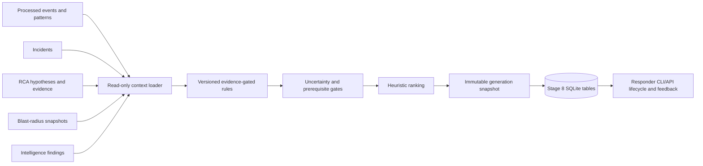

# Stage 8 Recommendation Engine

## Scope and boundaries

The recommendation package reads processed event payloads (Stage 3), incident membership/correlation snapshots (Stage 4), the latest RCA report (Stage 5), blast-radius snapshots (Stage 6), and the latest intelligence findings (Stage 7). It writes only Stage 8 tables. Source events, incidents, RCA reports, graph snapshots, and intelligence findings are read-only.

The engine emits advice for a human responder. It does not run commands, mutate infrastructure, restart services, edit configuration, or resolve incidents. Every output is an advisory rule result, not a root-cause assertion. A Stage 6 path means potential structural impact; Stage 7 detector outputs remain separate signals.

## Rule contract

`RecommendationRule` provides `rule_id`, `version`, `description`, `input_conditions`, `required_evidence`, `excluded_conditions`, recommendation `template`, priority/confidence logic, risk assessment, and verification procedure. The default catalog is in `recommendations/rules.py`; custom rule sets can be passed to `RecommendationEngine`. Rule IDs must be unique. Existing rule ID implementations have explicit match logic in the engine; adding a new rule requires a matching branch and tests.

Current rules cover database pool exhaustion, guarded admission control, authentication failures, notification failures, service errors/anomalies, RCA candidate diagnostics, Stage 7 detector disagreement, potential blast-radius checks, and recurrence monitoring. The default engine emits investigation/diagnostic/monitoring recommendations broadly and mitigation only for the narrow repeated-pool-saturation gate described below.

Every recommendation contains evidence references, contrary evidence where present, assumptions, service IDs, priority/urgency, a non-probabilistic confidence label, expected benefit, risk and side effects, prerequisites, implementation and verification steps, rollback guidance, stage/run/rule provenance, related identifiers, lifecycle state, and a heuristic score breakdown.

## Uncertainty rules

- Leading RCA hypotheses remain unconfirmed and are described as such.
- Competing hypotheses create separate diagnostic recommendations keyed to candidate event/service; they are not collapsed into one selection.
- An inconclusive RCA with no candidate produces an evidence-collection recommendation.
- Stage 7 statistical and Isolation Forest disagreement is preserved with both finding IDs and detector names.
- Blast-radius findings say “potential structural impact”; they recommend checking service health, not assuming failure.
- Missing context returns `insufficient_context`; a valid context with no matching rule returns `no_applicable_rule`.
- Strong/moderate/weak labels describe evidence basis, not calibrated confidence. Current built-in rules use moderate for repeated explicit event observations and weak for a single event, anomaly-only, pattern-only, RCA-candidate, detector-disagreement, or topology-only evidence. `insufficient_evidence` is used when no candidate support exists.

## Guarded mitigation

The `pool_admission_control` rule requires at least two distinct Stage 3 events with `active_connections >= pool_size > 0` and positive `wait_ms`, plus caller-supplied verified prerequisites `current_saturation_confirmed`, `approved_runbook`, and `payment_owner_approval`. Without all three prerequisite attestations, it produces no mitigation suggestion (the event-backed investigation remains available). It suggests an approved, temporary admission-control runbook only after a human confirms the incident remains active and current saturation is still present. The recommendation calls out payment delays/rejections and includes verification and rollback steps. It does not suggest increasing a database limit from the event alone. It is ranked after all investigation and diagnostic recommendations.

## Persistence and idempotency

The engine uses SQLite tables prefixed `recommendation_` plus a mutable current-state `recommendations` row. `recommendation_runs` and `recommendation_snapshots` preserve immutable generation output; `recommendation_history` audits transitions; `recommendation_feedback` stores responder outcomes; `recommendation_rules` pins rule versions; `recommendation_evaluations` stores synthetic evaluation results. The generation fingerprint covers input context, rule definitions, and configuration. Unchanged input/config returns the existing snapshot and stable IDs. Status changes do not rewrite the historical run snapshot.

## Lifecycle and feedback

Allowed transitions: `proposed -> acknowledged|dismissed|superseded`, `acknowledged -> in_progress|dismissed|superseded`, and `in_progress -> completed|dismissed|superseded`. Terminal states cannot transition further. Dismissal requires a reason. Completion is an operator record and does not imply incident resolution. Feedback outcomes are successful, unsuccessful, inconclusive, or not_attempted; feedback is retained for evaluation and does not train or change rules.

## Limitations

This first ruleset is intentionally conservative and has a narrow mitigation path. It does not query live metrics or logs; Stage 3 event metadata is historical evidence and current-state confirmation remains a prerequisite. Rule conditions are explicit Python logic paired with persisted rule descriptors, not an arbitrary expression language. There is no automated learning, action execution, or production validation.
