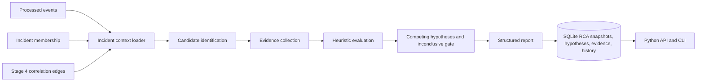
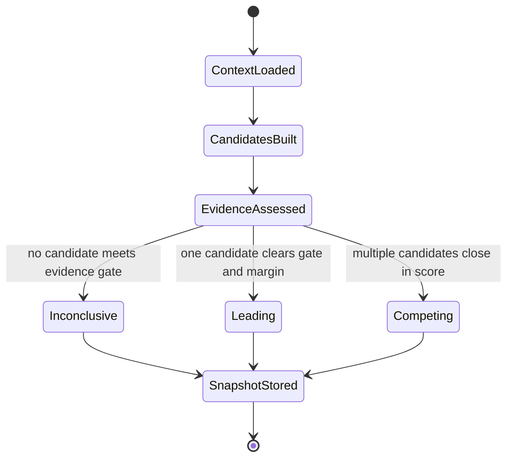

# Stage 5: Root Cause Analysis architecture

RCA is a derived investigation layer over Stage 4 incidents. It reads Stage 3 processed event payloads, incident membership, and Stage 4 edge evidence, and writes a separate immutable report snapshot. It does not mutate event records or Stage 4 edges.

Candidate identification treats classified failures and abnormal severities as candidate events. It does not promote the first timestamp by rule. Evaluation combines observed failure indicators, shared-resource context, configured dependency plausibility, Stage 3 pattern observations, Stage 4 associations, and temporal consistency. Each item is typed as an observed fact, inferred dependency, or correlated relationship. Metric/trace gaps are recorded; unavailable telemetry is unknown.

Service dependency data is a configurable hypothesis input, not a verified topology database. Metrics collection and independent cause verification are not available in this repository. Accordingly, `confirmed_causes` is always empty and the report never asserts a causal conclusion.

The engine is deterministic for a given persisted context/configuration. An input fingerprint generates a stable investigation ID. Existing fingerprints return their original stored report, preserving historical bytes even when code or configuration later changes.

## Lifecycle

SQLite `BEGIN IMMEDIATE` wraps snapshot, hypothesis, evidence, and history inserts. A deterministic investigation ID and unique `(incident_id, fingerprint)` make repeated requests idempotent. Reports are snapshots: a changed Stage 4 context/config produces a new fingerprint and a new investigation record.

Complexity: for `n` incident events and `e` correlation edges, the current context read is indexed by incident membership and event IDs; candidate scoring compares each candidate to incident events for shared resources, worst-case O(n²) for dense resource checks, plus O(e) edge association. It is intentionally incident-scoped rather than a global all-pairs analysis. Very large incidents should use resource indexes before expanding production workloads.
