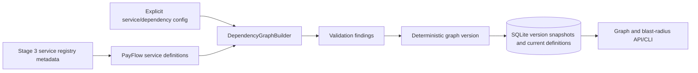

# Stage 6: Service Dependency Graph architecture

The `dependency_graph` package adds a separately testable graph model and versioned local persistence. It reads the Stage 3 service registry as service metadata, adds explicit criticality/business fields, and defines edges from simulator behavior. It does not alter event records, Stage 4 relationships, or Stage 5 hypothesis scoring.

## Direction and model

`A -> B` means **A depends on B**. Therefore if B fails, A is a potentially impacted dependent. Graph traversal for impacts walks the reverse adjacency. A graph edge is not a call direction guarantee or a causal claim.

Services store ID, display name, description, type, configurable criticality, business capability, environment, and metadata. Dependencies store source/target IDs, extensible type, importance, description, evidence source, optional confidence, verification status, and metadata.

PayFlow edges reflect the simulator sequence and data flow:

| Edge | Reason | Importance |
|---|---|---:|
| `api-gateway -> authentication-service` | Gateway authenticates the merchant before request handling. | 0.90 |
| `api-gateway -> payment-service` | Gateway forwards payments and returns the result. | 1.00 |
| `payment-service -> database-service` | Payment persistence uses the database; pool exhaustion blocks it. | 1.00 |
| `notification-service -> payment-service` | Receipt work consumes an authorized payment event. The simulator queues delivery retries; this is low-importance and does not block payment authorization. | 0.45 |

There is no modeled cache, broker process, or external mail-provider service because the simulator does not model those as service processes. `queue_is_simulated` metadata identifies the notification retry queue as a behavior, not a separately deployed service. Service metadata (`team`, `tier`, `kind`) is reused from Stage 3's registry.

## Build and validation flow

Graph version is a SHA-256 over normalized services, dependencies, validation findings, and configuration. Duplicate dependency definitions are collapsed deterministically and produce a warning. Missing service names/environments, missing source/target nodes, self-dependencies, bad importance/confidence ranges, duplicate service IDs, and invalid fields produce findings. Unknown dependency types are retained with warnings (type names are extensible). Tarjan strongly connected components identify cycles, including self loops. Weakly disconnected components outside the deterministic largest component receive `disconnected_service` findings. Invalid edges remain visible in the graph snapshot and are excluded from traversal if an endpoint is absent.

Cycles do not block analysis. Breadth-first traversal uses a visited-distance map; path enumeration uses a per-path visited set and a configurable output cap. Cycles that overlap reachable nodes are included in the report warnings.

## Persistence

`dependency_services` and `dependency_definitions` contain current definitions. `dependency_graph_versions` stores immutable graph snapshots and configuration. `blast_radius_analyses` stores immutable output, root service, graph version, incident and RCA IDs, deterministic fingerprint, and timestamp. Graph writes and analysis writes use `BEGIN IMMEDIATE`; deterministic graph hashes and analysis UUIDs make retries idempotent. Reconfiguring a graph writes a new version and leaves previous graph and report snapshots intact.
