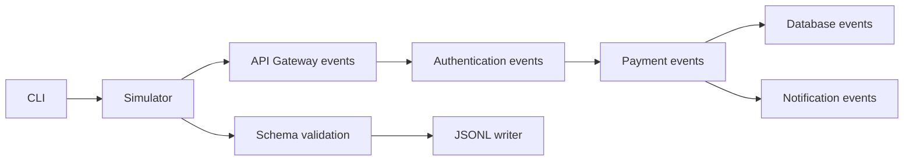

# System overview

Stage 1 is an in-process simulator for a fictional PayFlow system, not five deployed services. It emits events for API Gateway, Authentication Service, Payment Service, Database Service, and Notification Service using only Python's standard library.

The transaction is represented in causal event order. Pool exhaustion fails before persistence and returns a simulated 503. Notification provider failure happens after authorization; the payment succeeds while notification is queued for retry.

Stage 2 adds ingestion for JSON/JSONL, CSV, REST GET endpoints, and simulated live streams. Adapters produce source records; the engine normalizes and validates each independently, persists new IDs in SQLite, and appends invalid records to quarantine. See [event ingestion architecture](event-ingestion-architecture.md).

Stage 3 processes ingested records into separate enriched/classified/windowed payloads and deterministic pattern signals. Processing lifecycle and evidence are stored in SQLite so failed events can be retried and successful events explicitly replayed. See [event processing architecture](event-processing-architecture.md).

## Runtime path

`python -m payflow_simulator.cli` parses options, constructs `Simulator`, generates immutable `Event` instances, validates serialized events, and writes one compact JSON object per line. See [component interactions](component-interactions.md).
