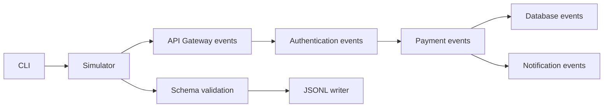

# System overview

Stage 1 is an in-process simulator for a fictional PayFlow system, not five deployed services. It emits events for API Gateway, Authentication Service, Payment Service, Database Service, and Notification Service using only Python's standard library.

The transaction is represented in causal event order. Pool exhaustion fails before persistence and returns a simulated 503. Notification provider failure happens after authorization; the payment succeeds while notification is queued for retry.

Stage 2 adds ingestion for JSON/JSONL, CSV, REST GET endpoints, and simulated live streams. Adapters produce source records; the engine normalizes and validates each independently, persists new IDs in SQLite, and appends invalid records to quarantine. See [event ingestion architecture](event-ingestion-architecture.md).

Stage 3 processes ingested records into separate enriched/classified/windowed payloads and deterministic pattern signals. Processing lifecycle and evidence are stored in SQLite so failed events can be retried and successful events explicitly replayed. See [event processing architecture](event-processing-architecture.md).

Stage 4 reads processed payloads and writes explainable correlation edges, heuristic confidence scores, incident membership, lifecycle history, trace diagnostics, and run metrics into additive SQLite tables. Correlation means observed association and does not prove cause. See [event correlation architecture](event-correlation-architecture.md).

## Runtime path

`python -m payflow_simulator.cli` parses options, constructs `Simulator`, generates immutable `Event` instances, validates serialized events, and writes one compact JSON object per line. See [component interactions](component-interactions.md).
# Stage 5 addition

The Root Cause Analysis layer consumes Stage 4 incident membership, processed event payloads, and correlation evidence. It writes separately versioned investigation snapshots, candidate hypotheses, evidence assessments, and history to the same local SQLite database. It distinguishes observed facts from associations and configured inferences; reports can be inconclusive and do not confirm causes. See [RCA architecture](root-cause-analysis-architecture.md).

Stage 6 adds an explicit, versioned service dependency graph and a reverse-edge blast-radius analysis. It stores graph snapshots and hypothetical analysis results in the shared SQLite database and can consume incident membership plus the latest RCA report without modifying either.

Stage 7 reads Stage 3 processed records, creates UTC event-time features and strictly prior rolling baselines, and stores independent statistical/Isolation Forest findings, temporal summaries, recurring signatures, and Stage 6 dependency context. Runs are immutable and fingerprinted; they do not alter incident or RCA records and do not claim causation.
