# Incident lifecycle and persistence

An incident is a connected component of strong accepted relationships. A correlated edge is not automatically strong. Distinct non-empty trace IDs are a boundary: temporal/dependency evidence cannot bridge them without an exact shared-resource edge. The minimum group size is two; unrelated singleton events remain in processed storage without incident membership.

```mermaid
stateDiagram-v2
  [*] --> active: first strongly related component
  active --> active: member added / severity updated
  active --> merged: strong edge joins components
  active --> active: split; anchor component retains ID
  active --> resolved: no strong relationships remain
  merged --> [*]
  resolved --> [*]
```

Initial IDs are UUID5 values based on the lexically smallest event ID, making initial runs reproducible. On merge, the oldest prior active incident ID (then lexical ID) survives; other IDs are retained as `merged` with `merged_into`. On split, the component containing the stable anchor event retains the prior ID; other components get deterministic UUID5 IDs derived from the prior ID and their smallest member ID. Repeated reconciliation reuses current memberships and does not duplicate history decisions.

Each event belongs to at most one current incident. A late-arriving processed event causes a full event-time reevaluation on the next run; it can add, merge, or split membership. Severity is the maximum member severity (`CRITICAL` > `ERROR` > `WARNING` > `INFO`). History records create, member addition, merge, split, and resolution decisions with supporting relationship endpoint IDs, strategies, and scores where available. `incident_members` represents current membership; historical changes remain in `incident_history`.

SQLite writes run metadata, correlation edges/evidence, incident changes, memberships, and lifecycle history inside `BEGIN IMMEDIATE` / commit. Errors roll back the run. Run IDs are deterministic hashes of inputs and configuration. Repeating the same run upserts edges and makes no duplicate membership/history decisions. Original Stage 1–3 event payloads are not updated.

This is full-rebuild reconciliation for the local prototype, not a distributed incident lease or multi-writer protocol. Historical split IDs remain as durable records; automatic incident retention is not implemented.
