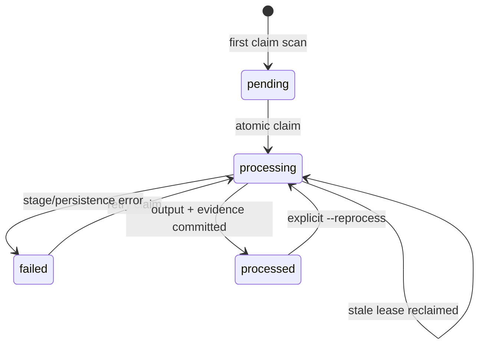

# Processing state lifecycle

State is keyed by event ID and includes status, current stage, attempt count, last error, update time, and processing run ID. Normal runs skip `processed` rows. Failed rows are retryable on a later run. A `processing` row becomes eligible after `stale_claim_seconds`, allowing recovery after process termination. `--reprocess` explicitly claims completed rows and upserts output while retaining attempt history. Per-source-order successful event-time observations keep watermark context stable across retries and replay.

The original ingested event remains in `events` through all state transitions. Output, observation, watermark, stage history, and `processed` state are committed in one transaction. If a replay fails, the last successful output remains available while the current state records failure; the source event remains retryable.
